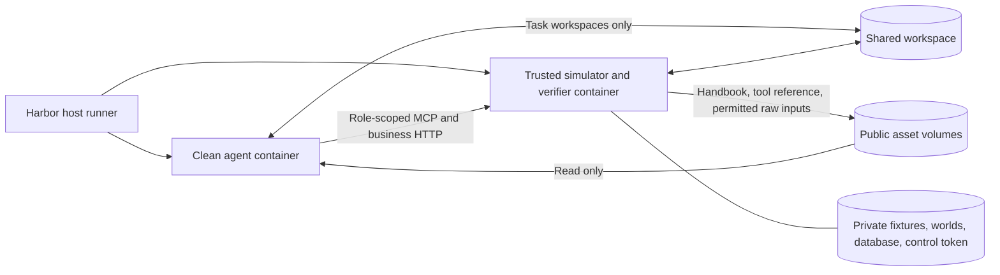

# chi-Bench Architecture

## Components

## Layers (`src/chi_bench/`)

- **core/** — domain models (`PriorAuthCase`, `CMOutreachTask`, ...), state machines, world store.
- **services/** — ~29 HTTP/MCP-backed domain services (chart, coverage, intake, p2p, ...).
- **server/** — FastAPI app exposing the services as REST endpoints under `/api/...`.
- **mcp/** — three MCP servers wrapping the services (provider, payer, CM).
- **conversation/** — patient simulator + P2P-session orchestration.
- **verifier/** — pluggable judge (WorkspaceJudge by default) + per-stage rubrics.
- **experiment/** — Harbor-driven trial runner + 7 agent harnesses + `dual-pa-e2e`.

## Trial lifecycle

> Flag-by-flag CLI reference: [`docs/cli.md`](cli.md).

1. `cb experiment run -f <config>` shells out to Harbor.
2. Harbor creates two containers through `ChiBenchDockerEnvironment`. Modal uses the same lifecycle inside a disposable Docker-in-Docker sandbox.
3. The trusted entrypoint selects the original task using `CHI_BENCH_TASK_ID`, bootstraps the simulator, and starts HTTP and the three MCP endpoints. It copies only the handbook, instruction, and selected tool reference into the public asset volume.
4. Harbor installs and executes the harness in the clean agent container. The containers share a network namespace and task workspace volume; their filesystems and process namespaces remain separate. Only permitted raw source artifacts are mounted read-only; the raw chart database stays private. Provider new-referral tasks receive no raw-artifact mount.
5. Management routes (`/export`, `/_oracle/solve`, and `/_admin/*`) require a random per-trial control token held by the trusted container. MCP and business HTTP requests are restricted to the active role. E2E role changes use host-side control operations.
6. Harbor's reserved `/tests` upload stops the entire agent container, closes tool admission, and waits for admitted calls to finish before uploading verifier inputs to the trusted container. A stop or drain failure prevents verification. Subsequent verifier commands execute there, with the original expectations and final workspace.
7. Verifier artifacts are downloaded from the trusted container; agent logs are downloaded from the stopped agent container. Teardown removes only this trial's containers, volumes, and network.

Workspace file operations use directory descriptors and `O_NOFOLLOW` to prevent the agent from making the trusted server follow links outside the shared workspace. The agent has no Docker socket, daemon client certificates, management credentials, or private simulator mounts.

Source-runner submissions pass the accepted data root, content identity and domain scope into each trial. The environment rechecks that source identity, then verifies the actual trusted container's selected task files, governing shared worlds, full handbook and selected tool-reference source before bootstrap. The guard is uploaded independently of the image, so a stale prebuilt image cannot bypass it. Direct experiments also check runtime materials when their source data root is known. A mismatch stops startup: rebuild the trusted image from the accepted data bundle before retrying, and keep the accepted hash unchanged. Custom data roots must match the image's shared materials; selecting different task files alone does not replace its worlds or handbook.

P2P completion requires evidence for the same request and case. A configured
simulated meeting must contain a completed agent/counterpart exchange. E2E uses
host-collected relay records: recording is allowed during the payer turn after
the provider message arrives, and final scoring requires both participants.
Ordinary agent-written files do not establish relay provenance. A trusted
operator can import an actual external consultation through
`/_admin/p2p_external_evidence`, with source reference, meeting time, participants,
summary and outcome. The existing `p2p.record_outcome` arguments then support
manual recording without a simulated dialogue. No-session paths without such
evidence return an explicit error rather than accepting a fabricated meeting.

E2E supports only the current `workflow_v2` execution/scoring protocol. It
requires Provider to submit a truthful packet and
Payer to process that actual packet in a separate model role context. This mode
uses actual two-role coordination and relay turns instead of single-role P2P
simulator replies. The trusted server retains the protocol in exported state;
verification and rejudging require that recorded version. Legacy or unversioned
E2E records cannot enter current scoring or aggregation. Original task evidence
and gold are unchanged. See [E2E scoring](judge.md#versioned-e2e-scoring).

Reference workflows and authored CM answers remain in the trusted package.
The authenticated oracle dispatches Provider/UM workflows, `workflow_v2` E2E
controls, and Marathon composition. CM returns static source-bound ideal
answers without running a patient simulation or verifier. These private
reference assets are never copied into the public agent asset volume.

Modal downloads agent logs from the stopped container into temporary outer
staging. Its archive excludes only `.tmp/plugins` and `cache/codex_apps_tools`;
the original logs remain unchanged and neither inner container executes cleanup.
The staging copy still temporarily occupies remote disk space.

The source `fixtures/` directory is a task bundle, not an agent-access allowlist. It can contain input materials together with expectations, judge materials, and hidden E2E policies. The complete bundle stays in the trusted container; the public projection determines which input assets reach the agent. Duplicate expectations under `fixtures/`, `tests/`, and `solution/` do not create an isolation boundary.

This boundary protects runtime assets. Publicly released task answers remain public information; formal blind evaluation requires unpublished evaluation tasks. Rebuilding or hiding local files cannot revoke an earlier public release.

When the payer confirms failed member eligibility, processing stops at intake.
`determination.finalize` can use the completed intake record to set the existing
case status `denied`, with reason `ELIG_TERMED`. The agent then generates and
delivers the denial letter. Clinical review is not required for this result.

## Why the LLM judge needs Anthropic credits

The verifier always uses `claude-opus-4-7` (configurable but paper-faithful default).
See `docs/judge.md`.
